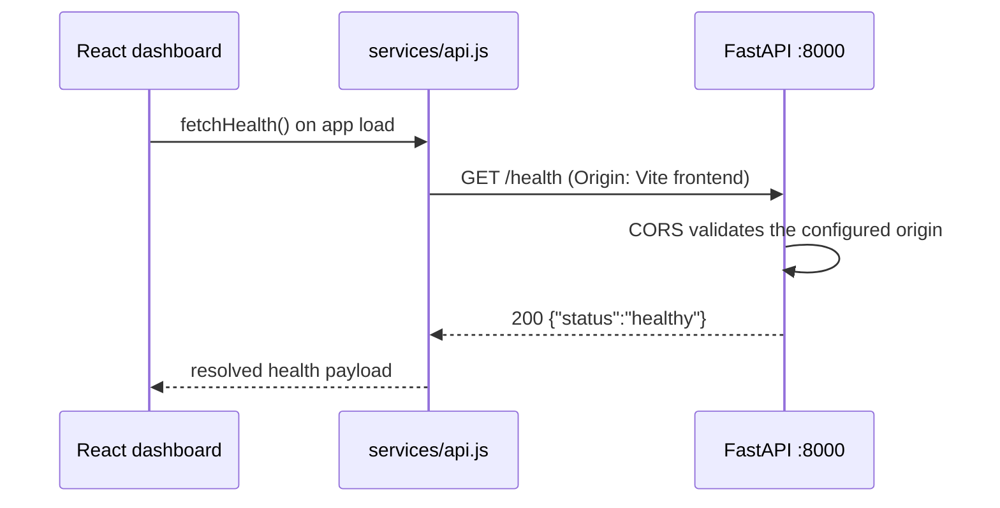

# ContractIQ Architecture

## Components

- **React + Vite frontend:** `frontend/src/App.jsx` owns page selection, connection state, responsive navigation, and the command palette. `Stage2Pages.jsx` provides projects/specification exploration and the compatibility dashboard; `TestingPage.jsx` handles test generation, execution configuration, results, and history.
- **Frontend API client:** `frontend/src/services/api.js` centralizes the configured backend URL, health check, projects/specifications, testing, compatibility comparisons, filtering, and JSON report downloads.
- **FastAPI backend:** `backend/app/main.py` configures the API and CORS. Separate route modules own health, projects, specifications, endpoints, testing, and compatibility comparisons.
- **Services:** OpenAPI parsing/import, deterministic compatibility analysis, test generation, outbound target validation, HTTPX execution, and response validation remain outside route handlers.
- **Persistence:** SQLAlchemy models use SQLite locally or PostgreSQL through `CONTRACTIQ_DATABASE_URL`. Alembic migrations manage schema changes; compatibility comparisons and individual findings are stored separately from test-run history.
- **Tests:** Pytest uses isolated in-memory SQLite databases for route tests. HTTPX execution tests use `MockTransport`, never production APIs.

## Health Request Flow

## Import and Testing Flow

An OpenAPI upload is parsed in memory with safe JSON/YAML parsers, validated against the OpenAPI schema, hashed, and stored as an immutable version with extracted endpoint rows. Test generation creates stable test cases from those persisted endpoints. Before execution, the caller provides a target base URL and execution settings. The backend checks exact host/port allowlists and network addresses, pins the DNS results in the HTTPX transport, then executes requests sequentially without redirects or environment proxy use. Status, media type, and schema validations are persisted with sanitized request/response details.

## Compatibility Comparison Flow

The compatibility route validates project membership, runs the deterministic engine against both stored raw OpenAPI documents, and persists the comparison and its findings in one transaction. The engine resolves local references only, normalizes path parameter names for endpoint matching, analyzes changes according to request/response direction, and calculates an indicative severity-weighted score. The dashboard reads saved history and paginated filtered findings from the API; JSON export uses the saved report rather than recomputing it.

## Configuration and Security Boundaries

`frontend/.env` sets `VITE_API_BASE_URL`; it is a public URL, not a secret. The backend reads `CONTRACTIQ_*` settings from its environment. Uvicorn's `--env-file` loads `backend/.env`; Alembic loads that same file when applying migrations.

CORS is enforced by browsers and is not authentication. Test execution is separately restricted by `CONTRACTIQ_TEST_ALLOWED_TARGET_HOSTS` and `CONTRACTIQ_TEST_ALLOWED_TARGET_PORTS`. Private targets are disabled by default; local-development access requires an explicit host/port allowlist and `CONTRACTIQ_TEST_ALLOW_PRIVATE_TARGETS=true`. Production environment runs cannot execute write methods. See [automated-testing-engine.md](automated-testing-engine.md) for all execution safeguards.
