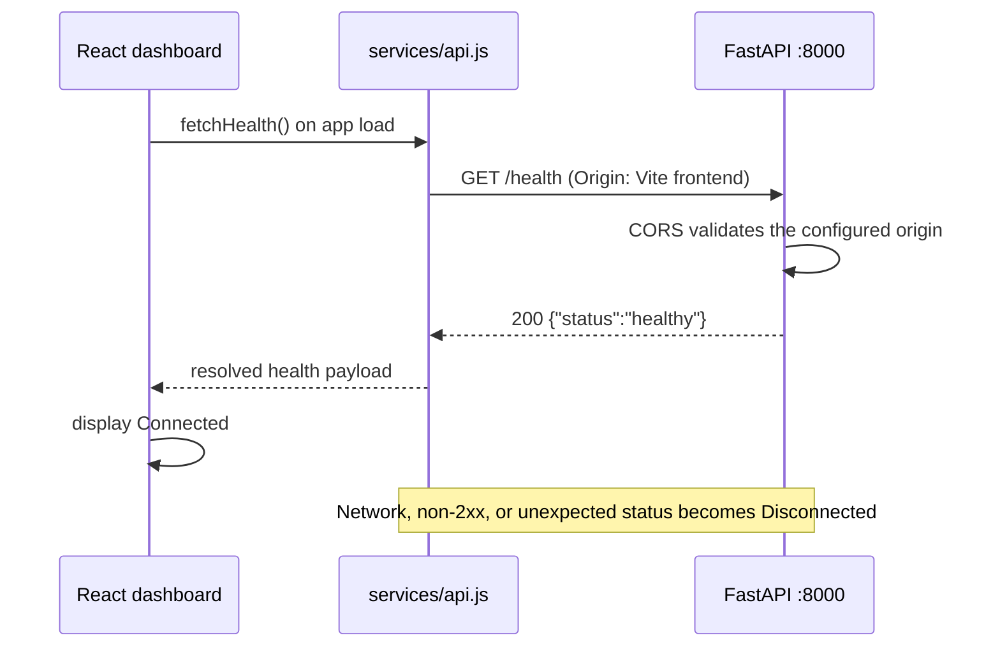

# ContractIQ Stage 1 Architecture

## Components

- **React + Vite frontend:** `frontend/src/App.jsx` owns page selection and the backend connection state. `Sidebar.jsx` handles section navigation; `Overview.jsx` and `PlaceholderPage.jsx` render the current and future-stage views.
- **API client:** `frontend/src/services/api.js` is the single place where the browser's backend URL and health request are defined.
- **FastAPI backend:** `backend/app/main.py` creates the application, configures CORS, and registers the system routes. `config.py` reads environment settings. `routes/health.py` owns health and versioned application status.
- **Tests:** `backend/tests/test_health.py` exercises endpoint contracts and the preflight response for the Vite origin.

## Health Request Flow

The frontend does not assume the backend is available: the initial state is `Checking backend`. A successful HTTP response with a `healthy` body changes it to `Backend connected`. Network failures, non-success HTTP status codes, and unexpected health payloads change it to `Backend disconnected`; the retry control performs the same request again.

## Configuration and CORS

`frontend/.env` sets `VITE_API_BASE_URL`, which Vite exposes to browser code at build/dev-server startup. It is a public URL, not a secret. The backend reads `CONTRACTIQ_APP_NAME`, `CONTRACTIQ_APP_VERSION`, and the comma-separated `CONTRACTIQ_ALLOWED_ORIGINS` from its process environment. Uvicorn's `--env-file` option loads `backend/.env` for local development.

The default backend origins are `http://localhost:5173` and `http://127.0.0.1:5173`. If Vite uses another port, add that exact origin to `CONTRACTIQ_ALLOWED_ORIGINS` and restart FastAPI. CORS is enforced by the browser; it is not authentication.

## Stage 1 Boundaries

Only the health and metadata API routes are implemented. The dashboard's API Projects, API Testing, Breaking Changes, Performance Monitoring, and Settings areas communicate that they are planned, but return no fabricated results. There is no specification upload, test runner, database, anomaly detection, or live event stream yet. Stage 2 can introduce an OpenAPI import module and persistence layer while retaining the existing app/router and frontend service boundaries.