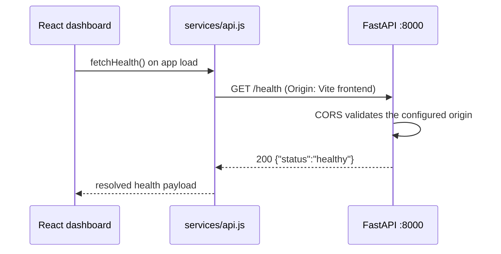

# ContractIQ Architecture

## Components

- **React + Vite frontend:** `frontend/src/App.jsx` owns page selection, connection state, responsive navigation, and the command palette. `MonitoringPage.jsx` provides monitoring setup, metrics, errors, anomaly, live, and alert screens.
- **Frontend API client:** `frontend/src/services/api.js` centralizes the configured backend URL and project/specification, testing, compatibility, monitoring, metrics, alerts, and WebSocket requests. Monitoring tokens are read from browser session storage rather than build-time variables.
- **FastAPI backend:** `backend/app/main.py` configures the API, CORS, and monitoring scheduler lifespan. Separate route modules own health, projects, specifications, endpoints, testing, compatibility, and monitoring.
- **Services:** OpenAPI parsing/import, deterministic compatibility analysis, test generation, outbound target validation, HTTPX execution, monitoring scheduling, metrics, alerting, anomaly detection, and response validation remain outside route handlers.
- **Persistence:** SQLAlchemy models use SQLite locally or PostgreSQL through `CONTRACTIQ_DATABASE_URL`. Alembic migrations manage schema changes; compatibility findings and monitoring configurations, checks, model metadata, anomalies, and alerts are stored separately from test-run history.
- **Tests:** Pytest uses isolated in-memory SQLite databases for route tests. HTTPX execution tests use `MockTransport`, never production APIs.

## Health Request Flow

## Import and Testing Flow

An OpenAPI upload is parsed in memory with safe JSON/YAML parsers, validated against the OpenAPI schema, hashed, and stored as an immutable version with extracted endpoint rows. Test generation creates stable test cases from those persisted endpoints. Before execution, the caller provides a target base URL and execution settings. The backend checks exact host/port allowlists and network addresses, pins the DNS results in the HTTPX transport, then executes requests sequentially without redirects or environment proxy use. Status, media type, and schema validations are persisted with sanitized request/response details.

## Monitoring Flow

An authorized project creates a monitoring configuration from selected public `GET`, `HEAD`, or `OPTIONS` endpoints. The application rejects write operations, declared authentication requirements, and unsupported required credentials/parameters. The lifespan scheduler claims due configurations using database lease fields, runs bounded synchronous HTTPX requests in worker threads, and reuses the exact allowlist, DNS validation, pinned transport, timeout, redirect, and response-size safeguards. Only status, latency, success/error category, endpoint template, and timestamp are persisted; response bodies and headers are discarded after contract validation.

Metrics and percentiles are aggregated from stored checks and can be filtered by time window and environment. A per-project Isolation Forest is trained only after a minimum number of real checks; until then, deterministic rules are labeled as the detection method. Model metadata is persisted and the estimator is rebuilt from measurements after restart rather than deserialized from a pickle file. Persistent alerts are deduplicated and published to a project-scoped WebSocket manager. Database leases coordinate scheduled checks across workers, while live WebSocket delivery remains process-local and requires a single worker for complete event delivery.

## Compatibility Comparison Flow

The compatibility route validates project membership, runs the deterministic engine against both stored raw OpenAPI documents, and persists the comparison and its findings in one transaction. The engine resolves local references only, normalizes path parameter names for endpoint matching, analyzes changes according to request/response direction, and calculates an indicative severity-weighted score. The dashboard reads saved history and paginated filtered findings from the API; JSON export uses the saved report rather than recomputing it.

## Configuration and Security Boundaries

`frontend/.env` sets `VITE_API_BASE_URL`; it is a public URL, not a secret. The backend reads `CONTRACTIQ_*` settings from its environment. Uvicorn's `--env-file` loads `backend/.env`; Alembic loads that same file when applying migrations.

CORS is enforced by browsers and is not authentication. Test execution is separately restricted by `CONTRACTIQ_TEST_ALLOWED_TARGET_HOSTS` and `CONTRACTIQ_TEST_ALLOWED_TARGET_PORTS`. Private targets are disabled by default; local-development access requires an explicit host/port allowlist and `CONTRACTIQ_TEST_ALLOW_PRIVATE_TARGETS=true`. Production environment runs cannot execute write methods. See [automated-testing-engine.md](automated-testing-engine.md) for all execution safeguards.

Monitoring REST and WebSocket routes require `CONTRACTIQ_MONITORING_AUTH_TOKEN` and an explicit `CONTRACTIQ_MONITORING_ALLOWED_PROJECT_IDS` project allowlist. The token is shared workspace access, not per-user identity; no user account or identity provider exists in this application. Use a single backend worker for WebSocket event delivery. See [real-time-monitoring.md](real-time-monitoring.md) for monitoring safety constraints and limitations.
